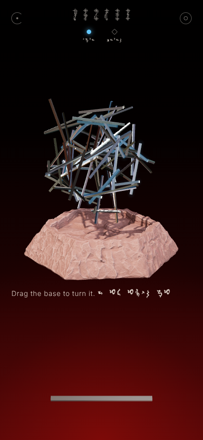

# Kal-toh

> "Kal-toh is to chess as chess is to tic-tac-toe."

A playable take on the Vulcan game of *Star Trek: Voyager*, as an Android app. A splintering
nest of steel *t'an* hangs over a stone basin, gathered about a centre mass and held by a field
that spins on a hidden axis. Players take turns placing one t'an at a time. Close a loop around
that hidden axis and it becomes a ring. Overload the structure and pieces fall. Ring by ring,
order comes out of the chaos, and when the form is complete the chaos falls away.

<p align="center">
  
  
  
  
  
</p>

## Install

1. Get the APK: `kaltoh/release/KalToh.apk` in this repository, or the `KalToh-apk` artifact
   of the latest **Build Kal-toh APK** run under the repository's *Actions* tab.
2. Open it on the phone. Android will ask you to allow installs from that source (the browser
   or file manager); allow it once, then install.
3. Needs Android 7.0 or newer with an up-to-date *Android System WebView* (any phone from the
   last several years). The game runs fully offline.

Every build is signed with the same sideload key (`android/app/sideload.keystore`, published
on purpose so updates install over each other; it is not a secret), so a newer APK installs
over an older one without uninstalling.

## How to play

| To | Do |
|---|---|
| Turn the base | Drag the stone or open space. Sideways spins it like a potter's wheel; up and down tips it toward or away from you. Let go mid-drag and it keeps turning. The base always turns about the centre of the sphere-to-be. |
| Spin the t'an | Drag the t'an themselves. The assembly has its own momentum: it lags behind the base and catches up, and spins on its own when you fling it. It never cuts into the stone. When it turns, the stone gives way just enough. When the stone is turned into it, the t'an are bumped aside and fall back into place. |
| Place a t'an | Put **two fingers** on the t'an lying at the foot of the screen to lift it. Move each finger onto a piece of the kal-toh. The two pieces glow blue, and the held t'an shows exactly where it will rest. Let go to place it. |
| Test the spin | Tap the spiral at the top left. The kal-toh spins on its hidden axis, and strained t'an glow amber. |
| Translate | Everything is written in Vulcan. **Wipe a finger across any line** and the Standard translation appears where your finger passed. Wipe again to return to Vulcan. The settings and rules pages translate the same way. |
| Ways to play | Tap the circle at the top right. |
| Begin anew | **Shake the phone for three seconds.** |
| Hologram | Tap the lens (or turn it on in the ways to play). See below. |

### The rules

- **The t'an** are all one length. They cling magnetically where they touch, and never pass
  through one another. The opening nest is made by dropping each t'an toward the centre mass
  until it comes to rest against two others. The nest is then tested against the game's hidden
  forces, so nothing floats and no chain hangs out further than its bonds can bear.
- **The hidden forces** change every game: an axis through the centre mass, a spin of unknown
  strength about it, and sometimes a steady drift. The spin flings every t'an outward from the
  axis and twists it toward lying square to it.
- **A move** places one t'an touching two pieces whose touch points are no further apart than
  its own length. It rests against them, never through anything.
- **Rings.** If the new t'an closes a loop that winds once around the hidden axis, and the loop is
  close enough to a ring's shape, its t'an slide into a regular polygon square to the axis, right
  where the loop was, meeting or crossing tip to tip. Whatever only hung from the loop falls away
  as it forms. A ring's joints are twice as firm as a chance crossing, and since it is centred on
  the spin, a ring carries its own load. A ring also reveals the axis to everyone.
- **Collapse.** After every move the spin tests the whole structure. If some bond cannot carry its
  load in any way the structure could share it, it gives way, the load shifts, and whatever no
  longer hangs from the centre mass falls. Strained t'an tremble and glow amber, a warning before
  they give.
- **Testing the spin** shows the axis, at the cost of a turn (or free, or forbidden: see the ways
  to play). A Vulcan opponent may test too.
- **Forms.** *Lantern*: three rings, at least one above the centre mass and one below.
  *Globe* (the default): four rings, at least one above, one below, and one about the middle.
  *Sphere*: six rings, two above, two below, one about the middle, and one crowning each pole.
  When the form is complete, everything that is not a ring, the centre mass, or holding them
  together falls away, and the finished kal-toh turns slowly on its axis.

### Ways of play

- **Harmony** (default): a ring scores one point per t'an in it. Each t'an your move drops
  costs one. Completing the form scores ten. The game ends when the form is complete or the
  t'an run out.
- **Collapse**: drop two or more t'an in one move and lose a life. The spin quickens every round.
  The last player standing wins.
- **Meditation**: alone, with no limit. Complete the form in as few moves as you can.

Opponent: a Vulcan *novice*, *adept* (default) or *master*, or nobody (pass and play, one to
four players). Other settings: the spin's strength (unknown by default), a drift, the axis hidden
or shown, a light, medium or dense nest, the cost of testing, *foresight* (see the ring a held
t'an would make, once the axis is known, always, or never), strain cues, *chains* (a ring earns
another turn, as boxes do in dots and boxes), the supply of t'an, lives, sound, vibration, and
whether text starts in Vulcan or Standard.

### Strategy

The axis is the secret. Until a ring forms or someone tests the spin, every loop you close is a
guess. Testing tells everyone, and it costs your turn. Once the axis is known, rings are a race,
and the game becomes one of tempo, as in dots and boxes. A loop left one t'an short of closing
is a ring for your opponent, so build toward rings only where you can finish them. Building far
out from the centre mass, or hanging long chains, risks a collapse that costs you points or a
life. In *collapse* the spin keeps rising, so every move must leave the structure stronger than
it found it.

### Hologram view

Turn on the hologram and allow the camera. The front camera then follows your face (nothing is
shown or stored), and the game moves its viewpoint with your eyes, including toward and away from
the screen, while the screen stays a fixed window onto the kal-toh. It seems to stand inside the
phone. Move your head, or the phone, to look around it. The camera is always released when the
game is in the background.

## How it is made

- **`android/app/src/main/assets/www/`**: the game, as plain ES modules on
  [three.js](https://threejs.org) (r186, vendored), with no build step.
  - The physics and rules, with no rendering (so they run and are tested under Node):
    - `geom.js`: vectors, quaternions, closest points between segments.
    - `nest.js`: t'an and bonds; growing a nest by dropping t'an toward the centre mass.
    - `statics.js`: will it hold? Every bond carries a force and a moment. A least-strain
      solution by preconditioned conjugate gradients, then iterative re-weighting toward the
      plastic limit (a structure stands if any distribution of its load keeps every bond within
      strength). Breaking and collapse follow.
    - `relax.js`: position-based relaxation. When a ring forms, contacts slide along the t'an to
      stay in touch, nothing interpenetrates, and the most stretched contact lets go first.
    - `rules.js`: placement, loops around the axis (a breadth-first search over how many times a
      path has crossed a cut around the axis), rings, forms, modes, scoring.
    - `ai.js`, `ai-worker.js`: the Vulcan. It tries moves on copies of the game, looks a reply
      ahead, and builds arcs round the axis. It knows the axis only once it has been revealed.
  - The view: `scene.js` (renderer, lights, mess-hall reflections, the stone, the head-coupled
    window), `motion.js` (base and assembly dynamics and collisions), `rodmesh.js` (brushed
    stainless t'an with a procedural lengthwise scratch normal map), `falling.js`, `tray.js`,
    `input.js`, `hud.js` (wipe-to-translate text, the ways to play), `settings.js`, `audio.js`
    (synthesized sound), `head.js`, `shake.js`, `main.js`.
- **`android/`**: a small Java shell (`MainActivity.java`, `HeadTracker.java`). It runs a full
  screen WebView that serves the game from the APK, and handles accelerometer shake detection,
  haptics, and the optional face tracking.
- **`tools/`**
  - `physics.test.mjs`: geometry, load paths, and growing nests.
  - `rules.test.mjs`: placement, rings, forms, modes, the Vulcan, and physical invariants
    checked after every move of many random games. Every t'an keeps its length, nothing passes
    through anything, nothing floats, and every bond bears its load.
  - `browser-check.cjs`: plays the real game in headless Chromium with simulated touch. It covers
    placing, the Vulcan's reply, a ring, turning and spinning, wiping text, the ways to play,
    and shaking to begin anew.
  - `convert_base.py`, `make_icon.py`: asset and icon generators.

```sh
node kaltoh/tools/physics.test.mjs
node kaltoh/tools/rules.test.mjs
node kaltoh/tools/browser-check.cjs out/   # needs Playwright with Chromium
```

### Build it yourself

```sh
# needs JDK 17+ and the Android SDK (ANDROID_HOME)
cd kaltoh/android
./gradlew assembleRelease
# -> app/build/outputs/apk/release/app-release.apk
```

To try the game in a desktop browser, serve `android/app/src/main/assets/www/` with any static
web server and open `index.html`. Press `R` to begin anew, `T` to test the spin, and use the
mouse wheel to draw nearer.

## Credits and notes

- Kal-toh and *Star Trek* belong to Paramount; this is an unofficial fan project for personal use.
- The Vulcan fonts (*Vulcan Script* for titles, *Modern Vulcan* for everything else), the stone
  basin model (made with Meshy) and the mess-hall panorama were supplied for this project. Their
  licences are not included; check them before distributing the app beyond personal use.
- three.js is MIT licensed (`android/app/src/main/assets/www/vendor/three.LICENSE`).
