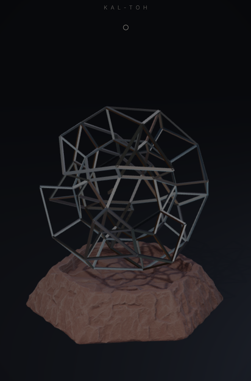
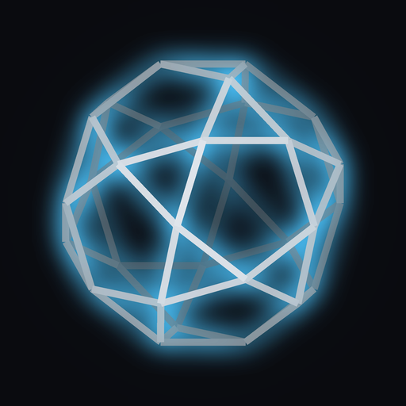

# Kal-toh

> "Kal-toh is to chess as chess is to tic-tac-toe."

A playable take on the Vulcan game of *Star Trek: Voyager*, as an Android app. You start from a
jagged jumble of magnetic rods (*t'an*) on a stone basin, and by adding rods one at a time you
bring the jumble into harmony until it becomes the kal-toh: two concentric icosidodecahedra
joined junction to junction.

<p align="center">
  
  
  
  
</p>

## Install

1. Get the APK: `kaltoh/release/KalToh.apk` in this repository, or the `KalToh-apk` artifact
   of the latest **Build Kal-toh APK** run under the repository's *Actions* tab.
2. Open it on the phone. Android will ask you to allow installs from that source (the browser
   or file manager); allow it once, then install.
3. Needs Android 7.0 or newer with an up-to-date *Android System WebView* (any phone from the
   last several years). The game runs fully offline.

Every build is signed with the same sideload key (`android/app/sideload.keystore`), so a newer
APK installs over an older one without uninstalling.

## How to play

There is almost no interface: the structure, the base and the tray are the game.

| To | Do |
|---|---|
| Turn the game | Drag the base (or anywhere) sideways; drag up or down to tilt your view. Pinch on open space to draw nearer. |
| Lift a t'an | Put **two fingers** on the rod lying in the tray and lift it. |
| Join two pieces | Keep holding and move each finger onto a t'an of the structure. The two pieces glow blue, their tips light up and the held rod shows the bond. Let go to join them. |
| Begin anew | **Shake the phone for three seconds.** A short shake does nothing. |
| Choose players | Tap the marks under the title before the first move (one to four players, in turn). |
| Hologram view | Tap the lens at the top right (see below). |

The instruction line at the foot of the board is written in Vulcan script with a Federation
Standard translation beneath it.

### The rules

- **The hidden form.** The jumble is the kal-toh scrambled. Its true skeleton is a tree of 29
  t'an from the outer icosidodecahedron, with every joint twisted about its own rod, so the joints
  keep their true angles: two t'an meeting at **60°** frame a triangle of the finished sphere,
  at **108°** a pentagon. The other 90 t'an of the jumble (the inner shell and the struts) are
  tangled through it. Only junctions of the hidden order answer your touch.
- **A move** joins the tips of two t'an with a new one. Because the skeleton is a tree, every
  join closes a loop, and the pieces shift until the tips meet.
  - *Harmony*: the tips are true neighbours in the sphere. The loop pulls into its true shape, a
    blue wave runs through the structure, and the tangled rods nearby glide into the inner shell.
  - *Discord*: they are not. The new t'an falls away in amber, shaking loose the newest bond at
    those tips, and the structure slips back toward chaos.
- **The secret spin.** The structure spins about a hidden axis, different every game. Every
  t'an is mass on that spin; when one side grows heavy the structure wobbles, circling the axis
  (which is how you find it). A join that would unbalance it past what it can bear is *flung*
  away even if it is true. Build evenly around the axis.
- **The end.** The sphere is complete when all 60 outer t'an are in place. The inner shell
  settles, the hidden axis is revealed, and the kal-toh turns slowly on it. Alone, you are told
  how many moves it took and how many t'an fell. With others, whoever places the final t'an wins:
  plan so that your rival is left with only discord or imbalance.

### Hologram view

Tap the lens at the top right and allow the camera. The front camera then follows your face
(nothing is shown or stored), and the game moves its viewpoint with your eyes while keeping the
screen a fixed window onto the structure, so the kal-toh seems to stand inside the phone. Move
your head, or the phone, to look around it. Tap the lens again to stop; the camera is always
released when the game is in the background.

It uses the camera's own face detection where the phone provides it, and Android's built-in
face detector otherwise. Your usual viewing position becomes the centre and drifts slowly with
you.

## How it is made

- **`android/app/src/main/assets/www/`** — the game: plain ES modules on
  [three.js](https://threejs.org) (r186, vendored), no build step.
  - `logic.js` — the rules, with no rendering: lattice, jumble generation, moves, balance.
  - `structure.js`, `inner.js` — the living structure: a position-based solver keeps every t'an
    rigid while junctions travel between chaos and order; the inner shell settles behind it.
  - `stage.js` — renderer, light, chrome reflections from the mess-hall panorama (its bright
    panels lifted to HDR), and the off-axis camera used by the hologram view.
  - `input.js`, `tray.js`, `falling.js`, `audio.js` (synthesized sound), `hud.js`, `head.js`,
    `shake.js`.
- **`android/`** — a small Java shell (`MainActivity.java`, `HeadTracker.java`): full screen
  WebView serving the game from the APK, accelerometer shake detection, haptics, and the
  optional face tracking.
- **`tools/`**
  - `logic.test.mjs` — rule tests plus a simulation that tuned the balance limit
    (`node kaltoh/tools/logic.test.mjs --tune`).
  - `browser-check.cjs` — plays the real game in headless Chromium with simulated multi-touch:
    lift, harmony, discord, a complete sphere, shake to begin anew.
  - `convert_base.py`, `make_icon.py` — asset and icon generators.

### Build it yourself

```sh
# needs JDK 17+ and the Android SDK (ANDROID_HOME)
cd kaltoh/android
./gradlew assembleRelease
# -> app/build/outputs/apk/release/app-release.apk
```

To try the game in a desktop browser, serve `android/app/src/main/assets/www/` with any static
web server and open `index.html` (press `R` to begin anew).

## Credits and notes

- Kal-toh and *Star Trek* belong to Paramount; this is an unofficial fan project for personal use.
- The Vulcan fonts (*Vulcan Script* for titles, *Modern Vulcan* for the inscription), the stone
  basin model (made with Meshy) and the mess-hall panorama were supplied for this project. Their
  licences are not included; check them before distributing the app beyond personal use.
- three.js is MIT licensed (`android/app/src/main/assets/www/vendor/three.LICENSE`).
