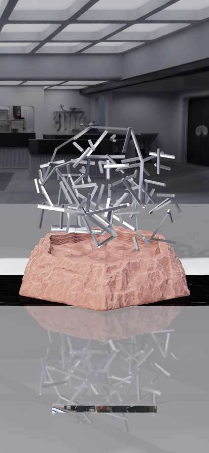
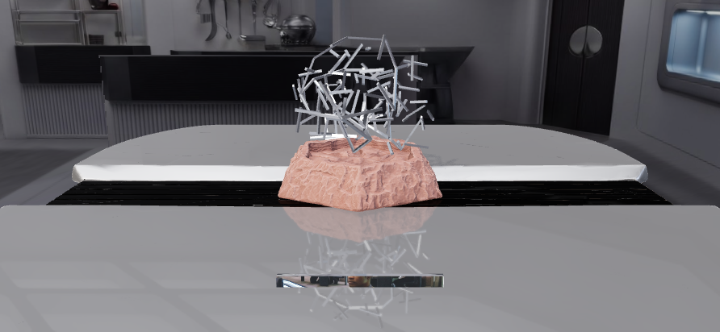
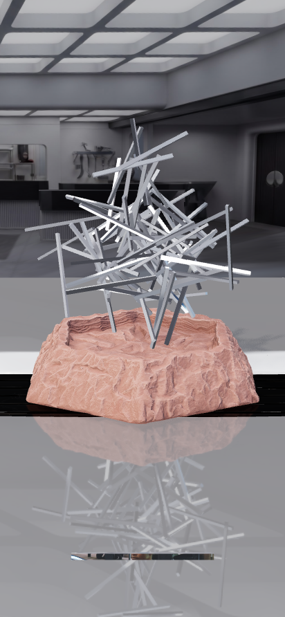
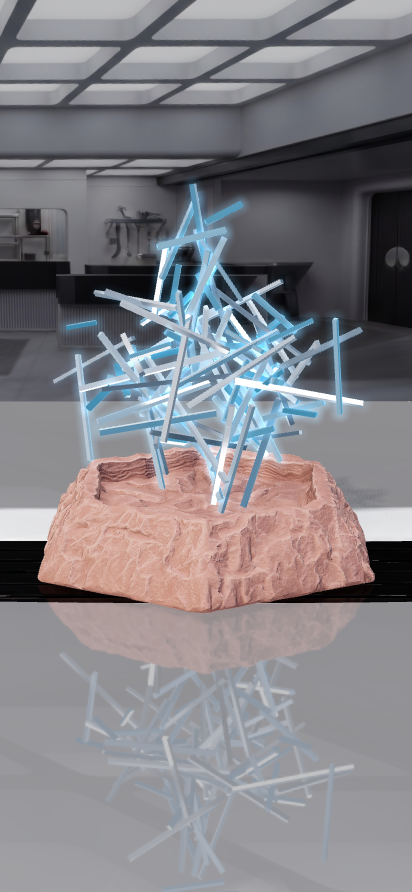
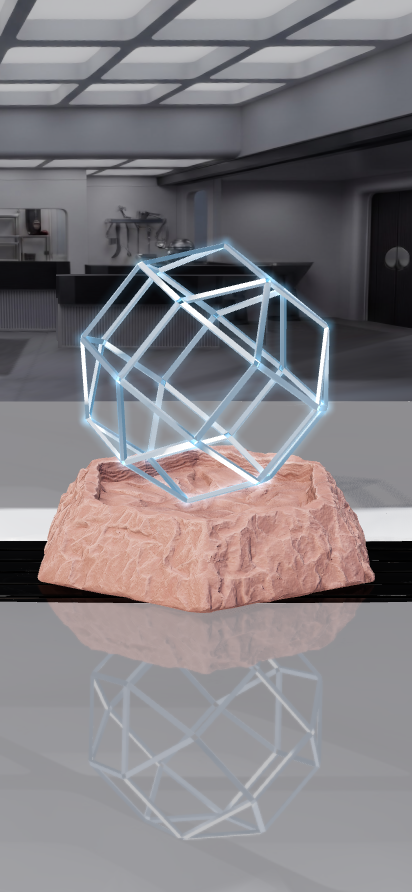
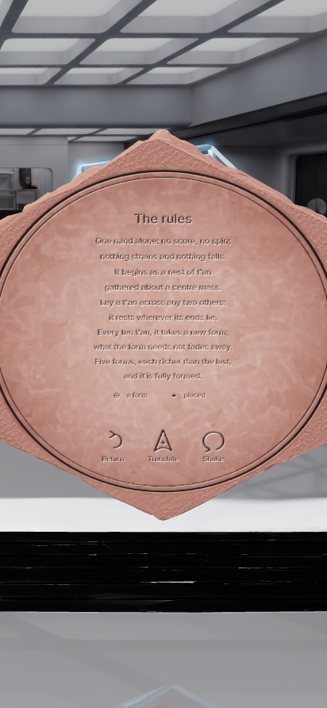

# Kal-toh

> "Kal-toh is to chess as chess is to tic-tac-toe."

A playable take on the Vulcan game of *Star Trek: Voyager*, as an Android app, with three games
of steel *t'an* on a stone basin:

- **The kal-toh**, the way to play at first. A jagged jumble of t'an rests over the basin. Join
  two tips at a time with a new t'an: true neighbours bring order, false bonds fall, until the
  jumble becomes the kal-toh, two concentric icosidodecahedra joined junction to junction,
  spinning true on its hidden axis.
- **Many forms.** A new form every game, built rather than found. A jumble hides one of fourteen
  solids whose loops are of more than one kind (triangles and hexagons, squares and octagons,
  ...), with a sample of its pattern already closed and loose t'an hanging among it as noise.
  Read the angles that repeat, close its loops one by one, and struts brace outward from each
  loop closed; then build the same form again on their tips, an outer shell round the inner.
- **Zen.** Alone and calm: no opponent, no score, and nothing falls. A splintering nest of t'an
  hangs over the basin, gathered about a centre mass: lay t'an across any two pieces you like.
  Every ten, the whole assembly glides into a form of many forms, each richer than the last;
  after the fifth it is fully formed.

Nothing is written on the screen. The title, the shape being built, the players, what just
happened and every control are carved on one face on the underside of the stone: tip the base over
to read them, from whichever side you like. All of it is engraved black, like the frame round it;
only the rings round the players' marks are painted, each in its player's colour. Ten minutes of
the mess hall loop beneath the play - the warp core's hum, the air, the crew's voices murmuring
under them - starting with your first touch; they play along with whatever else the phone is playing, never
pausing it. A voice can guide you through your first game, and each way to play the first time
you play it, answering what you do: silent at first, it waits until you turn it up under the
stone.
The stone stands on a silver pedestal table in Voyager's mess hall, seen from a seat at it: the
galley before you, its floor's lines running with the table's edges, and drawing nearer moves you
through the room. Held upright, the galley stands far back, from the pass-through block to the door
on the right, its ceiling's lights overhead; turned sideways, either way, it comes close, its
counters filling the wider screen from side to side (the photograph's own left side, not the galley
as it is, cut away, is never seen). Pinch to draw nearer or back: never so far, either way, that
you would see past the photograph. The table's satin top mirrors the room softly, the stone and the
t'an standing on it at half strength and the galley's ceiling lights faintly. The galley lights
them too, the same photograph stretched all round the table, mirrored behind you: softly on the
table and the stone, their shadows light and soft, while the t'an mirror it brightly, like polished
aluminium, its ceiling's lights glinting on them. The waiting t'an in the tray, its faces gently
domed, holds Tuvok at his table behind you - his whole panorama, so it keeps him as it dangles from
your finger - and its faces turned away catch the galley ahead.

<p align="center">
  
</p>
<p align="center">
  
</p>
<p align="center">
  
  
  
  
  
</p>
<p align="center">
  
  
  
  
  
</p>
<p align="center">
  
  
</p>

## Install

1. Get the APK: `kaltoh/release/KalToh.apk` in this repository, or the `KalToh-apk` artifact
   of the latest **Build Kal-toh APK** run under the repository's *Actions* tab.
2. Open it on the phone. Android will ask you to allow installs from that source (the browser
   or file manager); allow it once, then install.
3. Needs Android 7.0 or newer with an up-to-date *Android System WebView* (any phone from the
   last several years). The game runs fully offline.

Every build is signed with the same sideload key (`android/app/sideload.keystore`, published
on purpose so updates install over each other; it is not a secret), so a newer APK installs
over an older one without uninstalling.

## How to play

| To | Do |
|---|---|
| Turn the base | Drag the stone (a fingertip off its edge counts). Sideways spins it like a potter's wheel; up and down tips it toward or away from you, all the way over. Let go mid-drag and it glides on, then stops. The base always turns about the centre of the sphere-to-be. Level - its foot within twenty degrees of facing straight down - it rests on the floor, and spins there like a turntable; tip it further, toward you or away, and it lifts to turn freely. It never comes down while you hold it: let it go within twenty degrees of level and it falls straight down until its lowest edge meets the floor, then tips over on that edge until it lies flush, with a knock each time (held tipped a little as it rests, it rocks up onto its edge, never into the floor). Resting there, the t'an turned into it ride up over it rather than pushing it into the floor. **Two fingers** on the stone turn it as you see it instead: twist them and it turns about your line of sight, the same way round; move them together and it tumbles along with them; spread or pinch them (or two fingers on open space) to draw nearer or back, never so far either way that the room shows past the edges of its photograph. A drag on open space turns nothing, so a finger that only just misses the t'an at the foot of the screen sets nothing spinning. With the base turned over, grab it by its rim, outside the carving's framing circle: within the circle the carving is for touching, and nothing turns. |
| Turn the t'an | Drag anywhere within the t'an's outline, even between them (two fingers turn it as you see it, as for the stone). The assembly turns on the base and stays wherever you leave it. It has its own weight: when the base turns it lags behind and catches up, and flung, it coasts to a stop. Left alone it never moves on the base at all. It never cuts into the stone. While it turns, the stone gives way just enough; when the stone is turned into it, the t'an are bumped aside and settle against it. |
| Place a t'an | Touch the t'an lying at the foot of the screen with **one finger** to take it up: it dangles from your finger, swinging as you move, about as large as it lay in the tray - one finger is not enough to lay it. Put a **second finger** down anywhere and it is held by both. Two fingers on the tray at once lift it too. Held so, the t'an lies between your fingers at its own length, and **where its ends are is where it lands**: spread your fingers wide of the pieces, out of your own way, and lay its ends on them - in the original game and many forms, on the tips you mean to join (each end picks the tip nearest it, which lights up); in zen, anywhere on two different pieces. The pieces glow blue, and the held t'an shows exactly where it will rest (amber where it cannot, and the carving says why). Let go to place it. Let go of a t'an dangling from one finger, once you have carried it off the tray, and it falls into the room; flick it and it is thrown, up and away, to come down among the fallen. Either way another rises in the tray (barely moved, it goes back). The t'an waiting at the foot of the screen lies on the glass itself: it stays put however you draw the view nearer. |
| Read | **Tip the base over**, from any side. The carving is found with its top up whichever side it came up from, and as the underside comes to face you it draws near to be read. It is all on one face: the title, and beneath it the shape the game builds (in the original game *two concentric icosidodecahedra*; in many forms, this game's form; in zen, the form it has taken); whose turn it is and the score (in zen, its progress); what just happened (in many forms, and how many loops are closed; in zen, how far it has come); then, under a carved rule, the ways to play, the room, the sound, the voice and vibration; and three glyphs at the foot: *Rules*, *Translate* and *Shake*. *Rules* turns to the rules of the chosen game, short, and the marks under the seats; *Return* comes back. |
| Play with others | Two players take turns at first, passing the phone; choose one to four in the ways to play (in the original game and many forms; zen is played alone). Whose turn it is is told under the base, and only there: each seat is named (*Player 1*, *Player 2*, ...) over its mark, which is ringed in paint of its colour (red for the first player, a rich green for the second, then deep blue and gold), the mark filled for whose turn it is. Beneath is the score: true joins of those tried (*7/9*). Each player's plays are carved in order under their seat: a dot for a true join, a ringed dot for a great hoop or a loop closed, a cross where t'an fell. The rules show the marks. |
| Translate | Everything is carved in Standard at first. Touch the **Starfleet delta** carved among the glyphs, *Translate* beneath it (in Standard, whichever script the rest is in): all of it is smoothed away to bare stone and cut again in Vulcan, as deep - Golic Vulcan, the language itself, not English in Vulcan letters: *tal'uh zek svi'nezhak*, find the order within the chaos; *huta'uh*, shake; a score of 7/9, *steh t'nau*, seven of nine (every word, and where it comes from, in [docs/vulcan.md](docs/vulcan.md)). Touch it again for Standard. The carving reads in whichever script you left it in, the next time too. Touching the carving anywhere else translates nothing. |
| Ways to play | Carved on the face, under the players, in two columns: each way's name, and its value. First the game itself, with a line beneath on what it is, then its ways (how many players), then **Room** (the mess hall's sound around you), **Sound effects**, **Voice** (Sky's, guiding the play: silent at first, the guide waiting until you turn it up; down to nothing again, it guides no more), **Music** (Voyager's theme on piano, at half at first) and **Vibration** (every sound felt as well as heard, below). Each value chosen from a list (the game, the players, vibration) lies between two solid triangles, ◀ ▶, saying it can be changed: touch ▶, or anywhere else on its row, for the next choice, and ◀ for the one before. A change to the game waits for a new one: the rule across the face says *Shake to play this way*, and a ring is cut round *Shake*. Shake the phone, or touch *Shake*, to play that way. **Room**, **Sound effects**, **Voice** and **Music** are sliders: touch along the groove, or draw a finger along it, from silent to full (silenced, the room's sound and the music pause). |
| Feel it | With **Vibration** on, every sound is felt as well as heard, as strong as the sound: a tick for a slider's tenth or a t'an aimed anew, a click for each t'an struck (a crowd of them felt as one), a double click as one is set in place, a knock as the stone meets the table, a fine grain as t'an slide along one another and a coarser one as the stone grinds, a rising run for harmony and a ring for a hoop or a form taken, a double thud for discord, a swell for a t'an flung, slow throbs for a wobble, and for the kal-toh whole a run of strikes, a swell and a knock. The music's piano is felt too, note by note, lightly, as loud as it is heard. The room's hum is not. Each is played in firm pulses of the motor, long enough to be felt on any phone, and both as a game's media and as touch feedback, so that either of the phone's vibration settings lets it through. Switching **Vibration** on under the stone is felt at once, a firm double pulse: if even that is not felt, the phone's own settings hold vibration back (its master switch, or vibration for both media and touch turned off). |
| Begin anew | **Shake the phone for three seconds**, or touch *Shake* under the base: whatever the way, the kal-toh bursts apart, its t'an flung out to fall with the fallen, and all of them fade as the new game gathers. Nothing else begins a game anew: close the app (or let the phone close it) and open it again, and the game goes on where you left it - every t'an placed, the scores and whose turn it is, the t'an fallen where they lay, the stone turned as it was. |
| Be guided | A voice talks you through the game: *Sky*, one of the voices of the Kokoro speech model, every line spoken ahead of time and played from the app, offline. Your very first game is zen, where nothing can go wrong. The voice starts silent, waiting: turn **Voice** up under the stone and it says how loud it will be, greets you and takes up the game where it stands, and as you go tells you how to take up a t'an with one finger and hold it with two, what blue and amber mean, and how to turn the stone (never how to turn it over to find what is under it: you have done that, to turn the voice up). It watches what you do and answers it: a t'an left waiting, or dangling from one finger; one let go before its ends were on two pieces, or where it glowed amber; a refusal (the same tip twice, already joined, too far, too near); harmony, discord and what to look for; a wobble, a fling, noise, a loop closed, a form taken, a shake gathering. Turned over, it says that everything is there, and how to choose a way and begin it; and the first time you play each way, what that way is. Each lesson is given once, remembered from one day to the next; a mistake is explained again when it is made again, though not every time. It never speaks over itself, and the room's sound dips beneath it. **Voice**, under the stone, sets how loud it is; slide it back to nothing and it falls silent, and waits; turn it up again and it begins again from the welcome, every lesson given anew. |
| Draw nearer | Pinch, anywhere. |

### The kal-toh (the original game)

- **The hidden form.** The jumble is the kal-toh scrambled. Its true skeleton is a tree of 29
  t'an from the outer icosidodecahedron, with every joint twisted about its own t'an, so the
  joints keep their true angles: two t'an meeting at **60°** frame a triangle of the finished
  sphere, at **108°** a pentagon. The other 90 t'an (the inner shell and the struts between the
  shells) are tangled through it. Only junctions of the hidden order answer your touch.
- **A move** joins the tips of two t'an with a new one. A t'an reaches only tips about its own
  length apart as the jumble lies, no more than a quarter longer or shorter; it will not stretch
  to tips further apart, nor squeeze between tips closer together (it glows amber and goes back to
  the tray). Because the skeleton is a tree, every join closes a loop, and the pieces shift until
  the tips meet. If no true join lies within reach - after a run of false bonds, say - the jumble
  eases a little toward its order, and again, until one does (the carving says so), so every game
  can be finished.
  - *Harmony*: the tips are true neighbours in the sphere. The loop pulls into its true shape, a
    blue wave runs through the structure, and the tangled t'an nearby glide into the inner shell.
    Closing one of the six great hoops of ten sends a brighter wave round it.
  - *Discord*: they are not. The new t'an falls away in amber, shaking loose the newest bond at
    those tips, and the structure slips back toward chaos. Where the first tip truly belongs - its
    neighbours in the sphere not yet joined to it - glows a moment, so a mistake teaches.
- **The hidden spin.** The structure spins about a hidden axis, different every game. Every t'an
  is mass on that spin. A join that would unbalance it past what it can bear is *flung* away even
  if it is true; but one that brings it back toward balance always holds, even when a false bond
  has shaken loose what kept it within bounds. Brought close to that limit, it wobbles, and the
  carving warns you. Build evenly around the axis.
- **The end.** The sphere is complete when all 60 outer t'an are in place. The inner shell
  settles, a thread of light shows the axis, and the kal-toh glows. Alone, you are told how many
  moves it took and how many t'an fell. With others (one to four, taking turns), whoever places
  the final t'an wins: plan so that your rival is left with only discord or imbalance.
- Everything rests on the stone: the kal-toh keeps its place on the base,
  turns with it, is never cut into by it, and its fallen t'an lie where they fall until a new game.

### Many forms

- **A new form every game.** The jumble hides one of fourteen solids, each with t'an all of one
  length and loops of more than one kind: the truncated tetrahedron (triangles and hexagons), the
  cuboctahedron (triangles and squares), the truncated octahedron (squares and hexagons), the
  truncated cube (triangles and octagons), the rhombicuboctahedron (triangles and squares), the
  prisms of five to eight sides and the antiprisms of four to eight. It is turned any way up, and
  the jumble is twisted anew.
- **The jumble** is the inner form's skeleton, a tree of its t'an with every joint twisted about
  its own t'an, so the joints keep their true angles: **60°** a triangle, **90°** a square,
  **108°** a pentagon, **120°** a hexagon, **135°** an octagon. A sample of its pattern is already
  closed in its true shape: some of the loops about one junction, of more than one kind. Loose
  t'an hang among it as noise.
- **A move** joins two tips about a t'an apart with a new one, as in the original game (it will
  not stretch or squeeze; if no true join lies within reach, the jumble eases toward its form).
  - *Harmony*: true neighbours. The loop the new t'an closes pulls toward its true shape. A loop
    of the form closed whole finds its equilibrium: it glows round, holds for good (no false bond
    can shake it loose), and struts brace outward from each of its junctions. Noise hanging from a
    junction whose loops are all closed falls away.
  - *Discord*: not neighbours, or a tip of the noise. The new t'an falls, shaking loose the newest
    bond at those tips that no closed loop holds, and where the tip truly belongs glows a moment.
    Noise you touch falls away with it.
- **The outer shell.** When the inner form is whole, a strut stands out from every junction, the
  last of the noise falls, and the tray brings a longer t'an. Build the same form again on the
  struts' tips. The struts lean a little at first and find their true lines as the outer loops
  close about them, so copy the pattern of the shell within: two struts' tips are neighbours only
  if their junctions are.
- **The end.** Both shells whole, the kal-toh glows, its hidden axis shows, and the carving names
  the form. Alone, you are told how many moves it took; with others (one to four, taking turns),
  whoever made the most true joins prevails.

### Zen

- **Alone, and calm.** No opponent, no score, no hidden forces and no strain: nothing falls.
- **The nest.** It begins as a splintering nest of t'an over the basin, gathered about a centre
  mass: each t'an dropped toward it until it came to rest against two others, and the nest tested
  against a hidden spin, so nothing floats and no chain hangs out further than its bonds can bear.
- **A move** lays a t'an across any two pieces, anywhere along them: hold it so that its ends lie
  on two different t'an, and it rests there, against the side of each, at its own length (or,
  the pieces being further apart than that, just long enough to rest across both). Nothing else
  is asked: no reach, no true neighbours, no loop to close. Its ends on one piece only, it goes
  back to the tray.
- **Forms.** Every ten t'an placed, the whole assembly takes a form of many forms, at the size and
  in the place many forms builds its outer shell. In a wave outward from the junction nearest
  you, each t'an glides to a rod of the form, swinging out a little on its way: the form is
  turned whichever of many ways asks least travel of the t'an, and its rods are matched to the
  t'an so that all together go least far. T'an the form has no rod for fade away into light; if
  the form needs more, new t'an settle into place from just beyond it. A breath of air rises as
  they go and a chord swells beneath it, and the new form rings, a wave of light running across
  it, when every t'an is home. Then lay t'an across its pieces in turn: ten more bring the next.
- **Five forms**, each with more rods than the last: the truncated tetrahedron (18), the
  cuboctahedron (24), the octagonal antiprism (32), the truncated octahedron (36) and the
  rhombicuboctahedron (48). After the fifth it is fully formed: it glows, and the carving says so.
  Shake the phone, or touch the glyph that begins anew, for another.
- Under the base, beneath the name, the shape it has taken (*the nest* at first); where the other
  ways name their seats, its progress, a ringed dot for each form taken (of five) and a dot for
  each t'an placed toward the next (of ten); and under what just happened, the same in words
  (*Form 2 of 5: 4 of 10 t'an toward the next*). No seats, no scores.

### Strategy

In the original game, read the angles: a 60° joint is a triangle waiting to be closed, a 108°
joint a pentagon. Build evenly all round, and heed a wobble: one side has grown too heavy.

In many forms, look first at the sample: its loops tell you two of the form's kinds, and how they
meet at a junction. Then find the angles that repeat in the jumble, close small loops first (they
lock, and their struts mark the junctions that are settled), and look for the pattern of loops
round each junction: it is the same at every one. Leave the noise alone; a tip that hangs from a
single t'an at an angle no loop of the form would make is likely noise.

In Zen there is nothing to win and nothing to lose. Lay t'an where they please you: whatever you
build is gathered into the next form.

## How it is made

- **`android/app/src/main/assets/www/`**: the game, as plain ES modules on
  [three.js](https://threejs.org) (r186, vendored), with no build step.
  - The physics and rules, with no rendering (so they run and are tested under Node):
    - `geom.js`: vectors, quaternions, closest points between segments.
    - `nest.js`: t'an and bonds; growing a nest by dropping t'an toward the centre mass.
    - `statics.js`: will it hold? Every bond carries a force and a moment. A least-strain
      solution by preconditioned conjugate gradients, then iterative re-weighting toward the
      plastic limit (a structure stands if any distribution of its load keeps every bond within
      strength). Breaking and collapse follow.
    - `rules.js`: the nest Zen begins from, grown about the centre mass and tested against a spin
      about a hidden axis (statics.js) until enough of it holds.
    - `classic-rules.js`: the original game. The icosidodecahedral lattice, the jumble (a
      balanced spanning tree with every joint twisted, steered clear of the stone beneath it),
      harmony, discord, imbalance and the wobble.
    - `forms-rules.js`: many forms. The fourteen solids, each built from its points (rods as the
      closest pairs, loops walked round each junction's neighbours in turn), the jumble (a
      spanning tree holding the sample's loops, every other joint twisted), the noise, the leaning
      struts, the two shells, harmony, discord and easing.
    - `zen-rules.js`: Zen. The nest, a t'an resting across any two pieces, and every ten
      placed the next of five forms: the form tried turned many ways, its rods matched to the t'an
      so that together they travel least (squared, so paths seldom cross: the Hungarian method),
      the t'an left over fading, new ones filling the rods none reached.
  - The view: `classic.js` (the original game on the stone: the jumble's skeleton kept rigid by a
    small position-based solver as each junction finds its order, the inner shell settling into
    place, joining and the end), `forms.js` (many forms on the stone, in the same
    way: loops closing, struts growing out, noise falling away, the outer shell), `zen.js` (Zen on
    the stone: the nest gathering, t'an laid across any two pieces, and each form taken in a wave of
    gliding t'an, those it has no rod for fading into light, new ones settling in, its sound made of
    the synthesizer's own voices), `scene.js` (renderer, lights, the mess hall - the light everything
    is lit by and the metal mirrors, the galley's photograph seen beyond the kal-toh stretched
    twice round the table (ahead as taken, behind mirrored, so its edges meet), dimmed, its
    ceiling's lights lifted above white, and below, the silver table mirroring it all back up, the
    key light too - so the stone's carved underside, turned down to the table, is lit from there -
    the key light's shadows light and soft,
    each material taking it at its own strength (given it as its own: three.js lights what takes
    only the scene's environment at the scene's strength); the waiting t'an, and the one dangling
    from a finger, mirroring Tuvok, his old panorama whole in place of the galley behind the player;
    and the room the table stands in: a photograph of the galley, from well back in it, its left
    side (not the galley as it is) cut away, measured by its lines
    (`tools/measure_room.py`: where the floor's, the counters' and the ceiling's lines meet, the
    room's three directions, and from them its lens and how it was held, 1.4 degrees down and 17.2
    to the right of the room's length, from an eye 1.28 counters high, and where the counter, the
    block, the wall on the right and the back stand), projected from where it was taken onto the
    room's own floor and the counter's and walls' fronts (the counter and the wall behind it taken
    on past their ends, so the eye, to the right of where it was taken, never sees round them to
    what its camera never saw), the room laid along the table, so each ray from the eye takes the
    photograph's colour where it meets the room, and drawing nearer moves the eye through it; set
    lower than the table's foot and moved, never turned, so its lines still meet the table's: as
    far off as the screen allows, from the block to the door on a tall one, close on a wide one,
    never so that any of the screen sees past the photograph, or where its camera never saw, the
    view drawn no nearer or further than keeps to that, found by casting rays across the screen as
    the shader does, past the table (its top, and on a tall screen its front below the top's edge);
    should it be seen past its edges, the photograph goes on mirrored, the further past the softer
    and dimmer - the stone, and the window the screen becomes, framed afresh as the screen is
    turned), `table.js` (the pedestal
    table under the stone, its top at the floor, its near edge out of sight: satin silver (black
    where the model is) mirroring the mess hall at half strength, and the
    stone and t'an on it drawn a second time each frame, the eye turned over in the plane of the
    top, and the galley faintly, from where it stands nearest, its ceiling's lights overhead,
    without shadows, at the screen's own resolution and multisampled, softened only a touch), `motion.js` (base and assembly dynamics, and every t'an kept clear of
    the stone along its length), `rodmesh.js` (polished metal t'an: flat mirror faces, nothing
    bending what they reflect, the room looked up as sharp as the metal is smooth and as bright as
    polished aluminium, with a trace of aluminium's pale grey laid over it; only the waiting t'an's faces are domed, a little, so that
    it shows Tuvok whole enough to know; where t'an meet at a junction their
    ends are mitred in the shader, each corner cut back to the plane halving the angle to each
    other t'an there, so they meet the last millimetre to the last), `falling.js` (fallen t'an: tumbling, coming to rest on the
    stone or the table, or tipping off its edge and away, and staying until a new game; a t'an let
    go of as it dangled joins them, its own length where it seemed to hang, going as it was flicked), `tray.js`, `input.js`, `engrave.js`
    (everything written, carved on one face of the stone's underside - the ways to play among it,
    laid out from `settings.js` - on a layer whose depth the shader can smooth away and recut, the
    walls of its grooves found by the shader at each pixel from the depth cut, so they are crisp), `texts.js` (the words,
    in Golic Vulcan - from the Vulcan Language Institute's dictionaries, in the order of its
    grammar, its numbers counted as it counts them, and its stroke and half-stop, which the Vulcan
    fonts lack, cut by hand among the letters (`docs/vulcan.md`) - and in Standard), `settings.js`, `keep.js` (the game in
    play, kept every few seconds and whenever the app goes out of sight, in the page's storage and,
    on the phone, written down at once by the shell; opened again, each way takes its game up from
    its seed and all that play has changed - zen drawing its random numbers on from where they
    were - and the stone, the fallen t'an and what the carving said with it), `audio.js` (synthesized sound: every contact as its materials would sound - thin light metal on
    metal, rock on metal, rock on rock - each struck and drawn along), `shake.js`, `main.js`. `audio.js` also
    loops two recordings, the room's sound and the music, each through its own level, paused when
    silenced or out of sight; on the phone the shell plays them (`MainActivity.java`, a media player
    each that never asks for the audio focus, so other apps' sound plays on; out of sight each is let
    go, and coming back a fresh one takes it up where it was, from silence). The **Room** and
    **Music** sliders set their levels.
  - `guide.js`: the voice guiding the play. It hears what the game reports (a t'an taken up, held,
    aimed, let go, placed; every line the carving says) and watches what it can see (a t'an left
    waiting, the stone turned over, a shake gathering), and answers: each lesson once, remembered
    in the browser's storage; a mistake again when it is made again, but not within twenty seconds;
    never two lines at once, and none until the sound can be heard. Its lines are Kokoro's *Sky*
    voice, rendered ahead of time by `tools/make_voice.py` from `tools/voice-lines.json` into
    `assets/voice/` (about four minutes of speech, 1.7 MB) and played by `audio.js` at the Voice
    slider's level, the room's sound and the music dipping beneath.
- **`android/`**: a small Java shell (`MainActivity.java`). It runs a full screen WebView that
  serves the game from the APK, and handles accelerometer shake detection; it plays the room and
  the music (beginning them at once, at the levels last left, before the page has even loaded),
  and makes every sound felt - each kind's signature composed of the phone's tuned haptic
  primitives where it has them, firm pulses elsewhere, and the music's notes, from
  `assets/theme-notes.json`, as the piano strikes them.
- **`tools/`**
  - `physics.test.mjs`: geometry, load paths, and growing nests.
  - `rules.test.mjs`: the nest Zen begins from, of every density: every t'an keeps its length,
    nothing passes through anything, nothing floats, and every bond bears its load; and a seed
    reproduces it.
  - `classic.test.mjs`: the original game's lattice, jumbles (every t'an whole, every joint true),
    harmony, discord, and complete spheres, balanced and won by whoever places the last t'an;
    that played within a t'an's reach, with the jumble lying as the game draws it and easing when
    stuck, every game can be finished, mistakes and all; and that past the balance limit a join
    that restores balance still holds.
  - `ground.test.mjs`: the stone at rest on the floor when level, rocking up onto its edge (never
    into the floor) when held tipped a little, lifted to turn freely when tipped past twenty degrees,
    never coming down while held, and let go falling straight down to its edge, then tipping flush,
    knocking each time; resting there, t'an spun into it are lifted clear.
  - `forms.test.mjs`: many forms. Every solid (rods equal, loops flat and regular, junctions,
    rods and loops as a solid's), new games of them (the jumble keeps every t'an whole and every
    joint true, the sample in its true shape and place, noise, leaning struts), moves, loops
    holding and bracing outward, both shells completed, and that played within reach, easing
    when stuck, every game ends, mistakes and all.
  - `zen.test.mjs`: Zen. It begins as the seed's nest; a t'an rests across any two pieces, near
    or far, against both; ten placed bring a form, every t'an along its own rod of it or faded away,
    new ones where the form needs more; five forms, each with more rods than the last, and then it
    is fully formed; and t'an are matched to rods with the least travel there is (against every
    matching of small cases). And the ways to play: the kal-toh first, many forms and Zen, saved
    settings that once chose rings falling back to the kal-toh.
  - `browser-check.cjs`: plays the real game in headless Chromium with simulated touch. First the
    original game: the jumble grows, a t'an taken up by one finger and held by a second, its ends laid
    on two tips, joins true neighbours, tips too far apart for a t'an are refused, a false bond falls and shows where the
    tip belonged, no t'an passes into the stone, and t'an meeting at a
    junction are mitred to touch. Turned over, the base shows everything on one face (the name and
    the shape being built, the two players, what happened, the game and its ways, the room, the
    sound, the voice and vibration, and the glyphs, with no page to turn to and no row for the
    script); touching the game there changes it, the carving says to shake to play this way, and the
    glyph *Shake* plays many forms for two players: its form named under the title, the sample and
    the noise, a true join, the turn passing (told only under the board, the scene's light the same
    on each player's turn; each seat named, each one's plays kept for the carving), noise touched
    falling away, the inner form whole with struts at every junction and a longer t'an in the tray,
    a join on the struts' tips. Then it plays zen: the nest, a t'an laid across two pieces by touch,
    the five forms taken one after another (the rest of the t'an laid through the game's own hand),
    each with more rods than the last, and the kal-toh fully formed and glowing, the carving saying
    so. On it, it covers turning the base: the t'an lag, catch up, then hold perfectly still; a drag
    on open space below the stone turns nothing; two fingers twisted on the stone turn it about the
    line of sight. It turns the t'an by their area and checks no t'an ever passes into the stone. It
    turns the base over to read it (top up whichever way it was turned); a drag within the carving's
    circle turns nothing and a touch there does not translate it, but the Starfleet delta does
    (Standard at first, Vulcan then), and the script is remembered for next time. The rules glyph
    turns to the rules, and *Return* comes back. It draws a finger along the room's slider, sets the
    voice's level on its own slider, hears the music play at half, and changes the ways on the face
    for a new game. It covers
    fallen t'an staying until a new game, the game going on where it was when the page is opened
    again, and shaking to begin anew. A t'an let go of as it
    dangles falls into the room, a new one rising in the tray, and flicked, it is thrown and comes
    down on the table. Held sideways and back, the room comes nearer on the wide screen and stands
    back again, the view is framed afresh, and pinched it goes no nearer or further than the
    photograph allows; the stone stands clear of
    the tray, and turned over its carving is all on the screen. It checks that the stone stands on the table, its top at the
    floor, mirroring what stands on it (and then puts the table out of sight: drawing its metal
    makes the software renderer several times slower).
  - `convert_base.py`, `convert_table.py`, `make_icon.py`: asset and icon generators (the table at its
    full detail, 154,670 triangles; on the phone that is nothing, and its rounded edges need them).
  - `measure_room.py`: measures the galley's photograph by its lines, for `scene.js`'s room.
  - `make_theme_notes.py`: finds the piano's notes in the music (where its spectrum rises, struck),
    each with how hard it was played, into `assets/theme-notes.json`, for the phone to feel.
  - `make_voice.py`: renders the guide's lines with Kokoro (kokoro-onnx, the Sky voice) into
    `assets/voice/`, each brought to -14 LUFS so it is clear over the room's sound; unchanged
    lines are kept.
  - `vulcan.test.mjs`: every line the carving can cut in Vulcan is Golic Vulcan that can be cut,
    every word of it accounted for in `docs/vulcan.md`, its numbers as the Institute counts them,
    no English left; `vulcan-lines.mjs` prints that doc's table of every line.
  - `guide.test.mjs`: the guide, as a player would meet it - each lesson once, each mistake
    answered, nothing said while it cannot be heard or once turned down to nothing - and every line
    it can say written and rendered as written.
  - `keep.test.mjs`: the game kept between sessions: packed and unpacked exactly, and taken up
    again in each way, it goes on exactly as it would have (zen past taking new forms at random).

```sh
node kaltoh/tools/physics.test.mjs
node kaltoh/tools/rules.test.mjs
node kaltoh/tools/classic.test.mjs
node kaltoh/tools/forms.test.mjs
node kaltoh/tools/zen.test.mjs
node kaltoh/tools/ground.test.mjs
node kaltoh/tools/guide.test.mjs
node kaltoh/tools/vulcan.test.mjs
node kaltoh/tools/keep.test.mjs
node kaltoh/tools/browser-check.cjs out/   # needs Playwright with Chromium
```

### Build it yourself

```sh
# needs JDK 17+ and the Android SDK (ANDROID_HOME)
cd kaltoh/android
./gradlew assembleRelease
# -> app/build/outputs/apk/release/app-release.apk
```

To try the game in a desktop browser, serve `android/app/src/main/assets/www/` with any static
web server and open `index.html`. Drag with the mouse to turn the base, or the t'an by their
area; press `R` to begin anew, use the mouse wheel to draw nearer or back, and make the window
wider than tall to see it held sideways.

## Credits and notes

- Kal-toh and *Star Trek* belong to Paramount; this is an unofficial fan project for personal use.
- The Vulcan fonts (*Vulcan Script* for titles, *Modern Vulcan* for everything else), the stone
  basin and pedestal table models (made with Meshy), the mess-hall pictures (the galley,
  `assets/galley.jpg`, and the panorama with Tuvok at his table, `assets/tuvok.jpg`) and the
  ambience (`android/app/src/main/assets/www/assets/music.mp3`, already cut to ten minutes and
  faded in and out; made louder here) were supplied for this project, as was the music: a piano
  arrangement of Jerry Goldsmith's *Star Trek: Voyager* main theme (`assets/theme.mp3`; its quiet
  passages brought up here, gently compressed). Their licences are not included; check them
  before distributing the app beyond personal use.
- The guide's voice is *Sky* (`af_sky`) of Kokoro-82M by hexgrad (Apache 2.0), run with
  kokoro-onnx (MIT).
- three.js is MIT licensed (`android/app/src/main/assets/www/vendor/three.LICENSE`).
- The window the screen becomes follows Robert Kooima's *Generalized Perspective Projection*
  (2008).
