# Kal-toh

> "Kal-toh is to chess as chess is to tic-tac-toe."

A playable take on the Vulcan game of *Star Trek: Voyager*, as an Android app, with three games
of steel *t'an* on a stone basin:

- **The kal-toh**, the way to play at first. A jagged jumble of t'an rests over the basin. Join
  two tips at a time with a new t'an: true neighbours bring order, false bonds fall, until the
  jumble becomes the kal-toh, two concentric icosidodecahedra joined junction to junction,
  spinning true on its hidden axis.
- **Many forms.** A new form every game, built rather than found. A jumble hides one of fourteen
  solids whose loops are of more than one kind (triangles and hexagons, squares and octagons,
  ...), with a sample of its pattern already closed and loose t'an hanging among it as noise.
  Read the angles that repeat, close its loops one by one, and struts brace outward from each
  loop closed; then build the same form again on their tips, an outer shell round the inner.
- **Rings.** A splintering nest of t'an hangs over the basin, gathered about a centre mass and
  held by a field that spins on a hidden axis. Close a loop around that axis and it becomes a
  ring. Overload the structure and pieces fall. Ring by ring, order comes out of the chaos.

Nothing is written on the screen. The title, the instructions and every control are carved into
the underside of the stone: tip the base over to read them, from whichever side you like. All of
it is engraved black, like the frame round it; only the rings round the players' marks are painted,
each in its player's colour. Ten minutes of ambience loop quietly beneath the play, starting with
your first touch; they play along with whatever else the phone is playing, never pausing it.

<p align="center">
  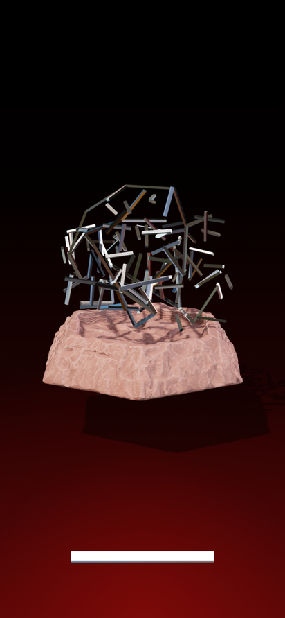
  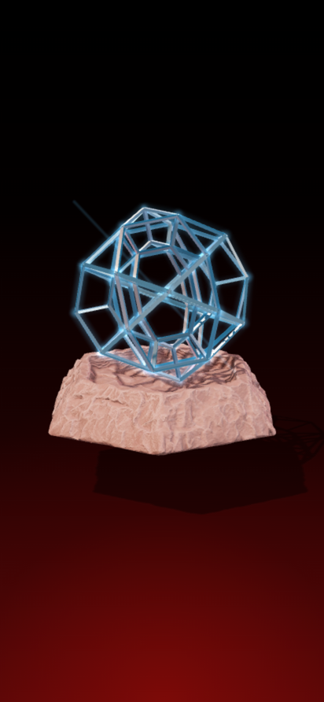
  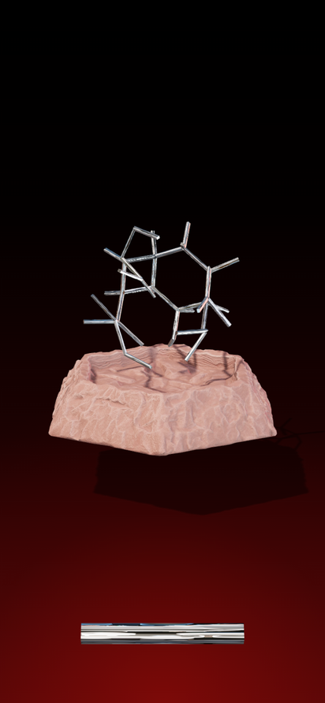
  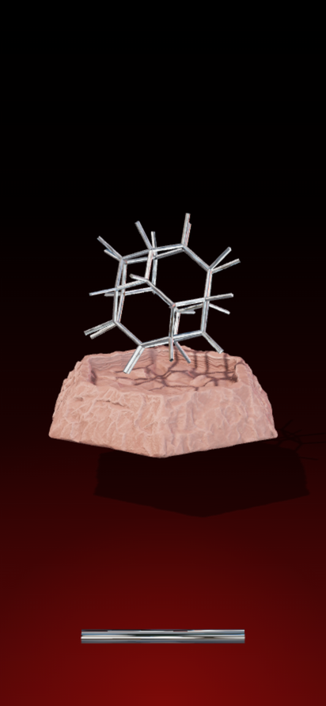
  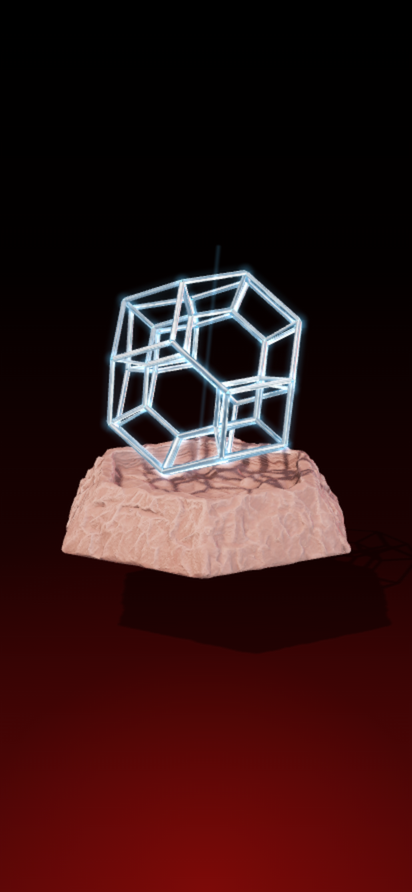
</p>
<p align="center">
  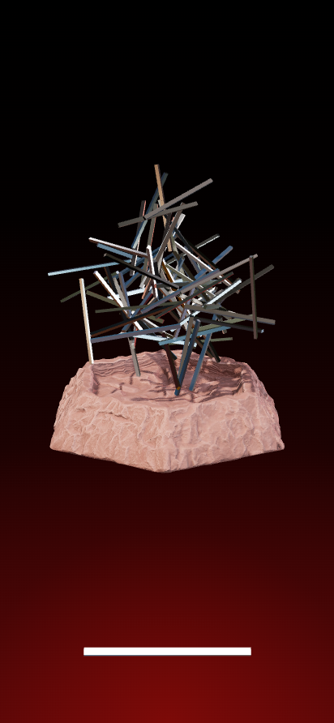
  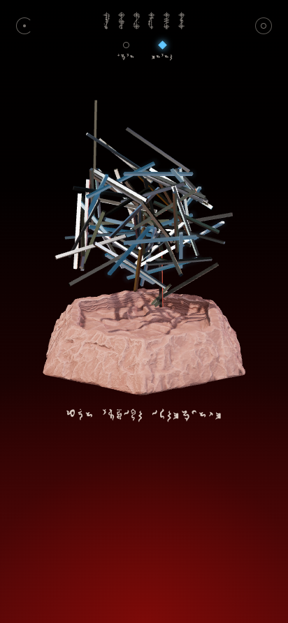
  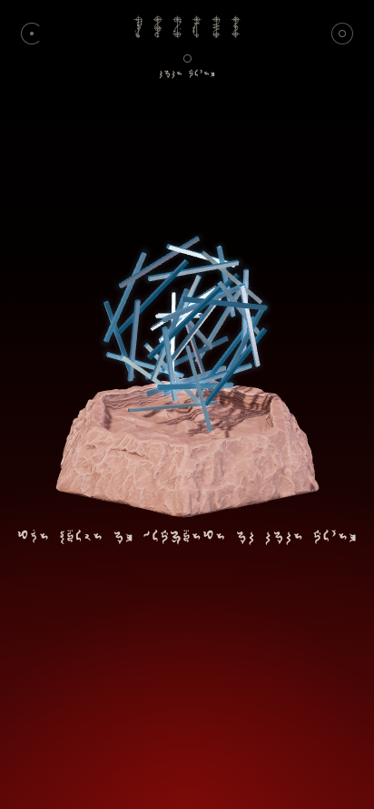
  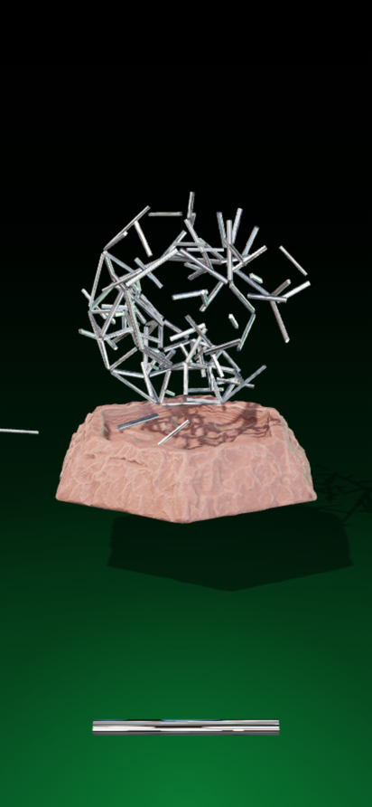
  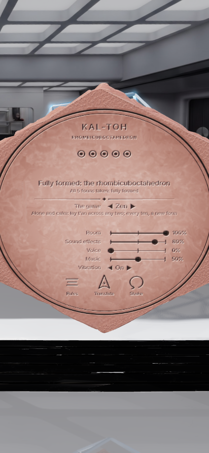
</p>
<p align="center">
  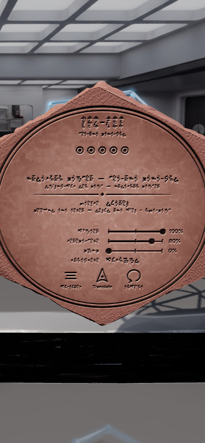
  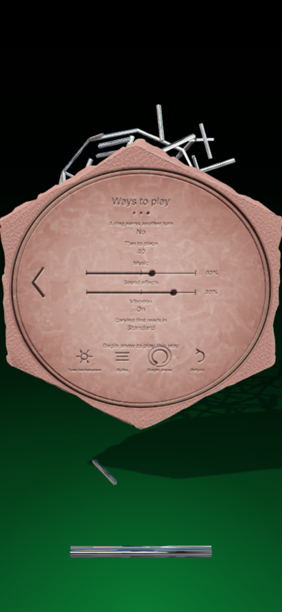
  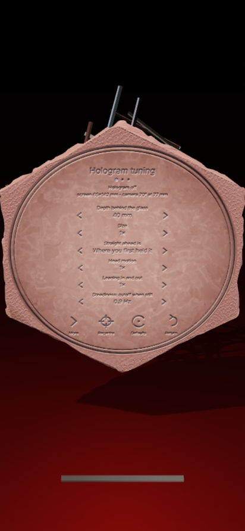
</p>

## Install

1. Get the APK: `kaltoh/release/KalToh.apk` in this repository, or the `KalToh-apk` artifact
   of the latest **Build Kal-toh APK** run under the repository's *Actions* tab.
2. Open it on the phone. Android will ask you to allow installs from that source (the browser
   or file manager); allow it once, then install.
3. Needs Android 7.0 or newer with an up-to-date *Android System WebView* (any phone from the
   last several years). The game runs fully offline.

Every build is signed with the same sideload key (`android/app/sideload.keystore`, published
on purpose so updates install over each other; it is not a secret), so a newer APK installs
over an older one without uninstalling.

## How to play

| To | Do |
|---|---|
| Turn the base | Drag the stone (a fingertip off its edge counts). Sideways spins it like a potter's wheel; up and down tips it toward or away from you, all the way over. Let go mid-drag and it glides on, then stops. The base always turns about the centre of the sphere-to-be. Level - its foot within ten degrees of facing straight down - it rests on the floor, and spins there like a turntable; tip it further, toward you or away, and it lifts to turn freely, and set it level again and it falls back to the floor with a knock (tipped a little as it rests, it rocks up onto its edge, never into the floor). **Two fingers** on the stone turn it as you see it instead: twist them and it turns about your line of sight, the same way round; move them together and it tumbles along with them; spread or pinch them to draw nearer or further. A drag on open space turns nothing, so a finger that only just misses the t'an at the foot of the screen sets nothing spinning. With the base turned over, grab it by its rim, outside the carving's framing circle: within the circle the carving is for touching, and nothing turns. |
| Turn the t'an | Drag anywhere within the t'an's outline, even between them (two fingers turn it as you see it, as for the stone). The assembly turns on the base and stays wherever you leave it. It has its own weight: when the base turns it lags behind and catches up, and flung, it coasts to a stop. Left alone it never moves on the base at all. It never cuts into the stone. While it turns, the stone gives way just enough; when the stone is turned into it, the t'an are bumped aside and settle against it. |
| Place a t'an | Touch the t'an lying at the foot of the screen with **one finger** to take it up: it slides across the glass under your finger, drawing in to the size it will be at the kal-toh as you raise it. Put a **second finger** down anywhere and it is held by both. Two fingers on the tray at once lift it too. Held so, the t'an lies between your fingers at its own length, and **where its ends are is where it lands**: spread your fingers wide of the pieces, out of your own way, and lay its ends on them - in the original game and many forms, on the tips you mean to join (each end picks the tip nearest it, which lights up); in rings, anywhere on a piece. The pieces glow blue, and the held t'an shows exactly where it will rest (amber where it cannot, and the carving says why). Let go to place it; let go of a t'an held by one finger only and it goes back to the tray. The t'an waiting at the foot of the screen lies on the glass itself: it stays put however you move your head or draw the view nearer, and while the kal-toh spins. |
| Read | **Tip the base over**, from any side. The carving is found with its top up whichever side it came up from, and as the underside comes to face you it draws near to be read: the title, whose turn it is and the score, what just happened, and how to play. |
| Play with others | Choose two to four players (or a Vulcan, in rings) in the ways to play. The light behind the kal-toh takes the colour of whoever's turn it is: red for the first player, a rich green for the second, then deep blue and gold. A finished game keeps its winner's colour. Under the base each seat is named (*Player 1*, *Player 2*, ... or *The Vulcan*) over its mark, which is ringed in paint of its colour, the mark filled for whose turn it is. Beneath is the score: in the original game and many forms, true joins of those tried (*7/9*); in rings, points. Each player's plays are carved in order under their seat: a dot for a true join (or a t'an placed), a ringed dot for a great hoop, a loop closed or a ring, a cross where t'an fell, a circle for a spin test. The rules page shows the marks. |
| Translate | Everything is carved in Vulcan. Touch the **Starfleet delta** carved among the glyphs, *Translate* beneath it (in Standard, whichever script the rest is in): all of it is smoothed away to bare stone and cut again in Standard, as deep. Touch it again for Vulcan. Touching the carving anywhere else translates nothing. |
| Test the spin | **Tap the t'an twice**, or touch the spiral carved under the base. The kal-toh spins on its hidden axis: in the original game and many forms an unbalanced one wobbles; in rings, strained t'an glow amber. The t'an waiting in the tray stays there. |
| Ways to play | Touch the circle carved under the base. The first way is the game itself. Touch a value to change it; some say beneath what they mean. Where there are more ways than fit, a large **arrow carved at the rim** turns the page, and one on the other side turns back. A change to the game waits for a new one: the carving says so and a ring is cut round *begin anew*. Touch it to play that way. **Music** and **Sound effects** are sliders: touch along the groove, or draw a finger along it, from silent to full (silenced, the music pauses). The lens with rays there opens the hologram's tuning. |
| Begin anew | **Shake the phone for three seconds**, or touch *begin anew* under the base. |
| Draw nearer | Pinch, anywhere. |
| Hologram | Touch the lens carved under the base: beneath it is carved *Hologram on* or *Hologram off*. It is also the first row of the hologram's tuning. See below. |

### The kal-toh (the original game)

- **The hidden form.** The jumble is the kal-toh scrambled. Its true skeleton is a tree of 29
  t'an from the outer icosidodecahedron, with every joint twisted about its own t'an, so the
  joints keep their true angles: two t'an meeting at **60°** frame a triangle of the finished
  sphere, at **108°** a pentagon. The other 90 t'an (the inner shell and the struts between the
  shells) are tangled through it. Only junctions of the hidden order answer your touch.
- **A move** joins the tips of two t'an with a new one. A t'an reaches only tips about its own
  length apart as the jumble lies, no more than a quarter longer or shorter; it will not stretch
  to tips further apart, nor squeeze between tips closer together (it glows amber and goes back to
  the tray). Because the skeleton is a tree, every join closes a loop, and the pieces shift until
  the tips meet. If no true join lies within reach - after a run of false bonds, say - the jumble
  eases a little toward its order, and again, until one does (the carving says so), so every game
  can be finished.
  - *Harmony*: the tips are true neighbours in the sphere. The loop pulls into its true shape, a
    blue wave runs through the structure, and the tangled t'an nearby glide into the inner shell.
    Closing one of the six great hoops of ten sends a brighter wave round it.
  - *Discord*: they are not. The new t'an falls away in amber, shaking loose the newest bond at
    those tips, and the structure slips back toward chaos. Where the first tip truly belongs - its
    neighbours in the sphere not yet joined to it - glows a moment, so a mistake teaches.
- **The hidden spin.** The structure spins about a hidden axis, different every game. Every t'an
  is mass on that spin. A join that would unbalance it past what it can bear is *flung* away even
  if it is true; but one that brings it back toward balance always holds, even when a false bond
  has shaken loose what kept it within bounds. Test the spin to find the axis: a balanced kal-toh spins true, an unbalanced one
  wobbles, its axis circling toward the heavy side. Build evenly around it.
- **The end.** The sphere is complete when all 60 outer t'an are in place. The inner shell
  settles, a thread of light shows the axis, and the kal-toh glows. Alone, you are told how many
  moves it took and how many t'an fell. With others (one to four, taking turns), whoever places
  the final t'an wins: plan so that your rival is left with only discord or imbalance.
- Everything rests on the stone as the rings game does: the kal-toh keeps its place on the base,
  turns with it, is never cut into by it, and its fallen t'an lie where they fall until a new game.

### Many forms

- **A new form every game.** The jumble hides one of fourteen solids, each with t'an all of one
  length and loops of more than one kind: the truncated tetrahedron (triangles and hexagons), the
  cuboctahedron (triangles and squares), the truncated octahedron (squares and hexagons), the
  truncated cube (triangles and octagons), the rhombicuboctahedron (triangles and squares), the
  prisms of five to eight sides and the antiprisms of four to eight. It is turned any way up, and
  the jumble is twisted anew.
- **The jumble** is the inner form's skeleton, a tree of its t'an with every joint twisted about
  its own t'an, so the joints keep their true angles: **60°** a triangle, **90°** a square,
  **108°** a pentagon, **120°** a hexagon, **135°** an octagon. A sample of its pattern is already
  closed in its true shape: some of the loops about one junction, of more than one kind. Loose
  t'an hang among it as noise.
- **A move** joins two tips about a t'an apart with a new one, as in the original game (it will
  not stretch or squeeze; if no true join lies within reach, the jumble eases toward its form).
  - *Harmony*: true neighbours. The loop the new t'an closes pulls toward its true shape. A loop
    of the form closed whole finds its equilibrium: it glows round, holds for good (no false bond
    can shake it loose), and struts brace outward from each of its junctions. Noise hanging from a
    junction whose loops are all closed falls away.
  - *Discord*: not neighbours, or a tip of the noise. The new t'an falls, shaking loose the newest
    bond at those tips that no closed loop holds, and where the tip truly belongs glows a moment.
    Noise you touch falls away with it.
- **The outer shell.** When the inner form is whole, a strut stands out from every junction, the
  last of the noise falls, and the tray brings a longer t'an. Build the same form again on the
  struts' tips. The struts lean a little at first and find their true lines as the outer loops
  close about them, so copy the pattern of the shell within: two struts' tips are neighbours only
  if their junctions are.
- **The end.** Both shells whole, the kal-toh glows, its hidden axis shows, and the carving names
  the form. Alone, you are told how many moves it took; with others (one to four, taking turns),
  whoever made the most true joins prevails. Two taps test the spin, as in the original game: a
  half-built kal-toh wobbles.

### Rings

- **The t'an** are all one length. They cling magnetically where they touch, and never pass
  through one another. The opening nest is made by dropping each t'an toward the centre mass
  until it comes to rest against two others. The nest is then tested against the game's hidden
  forces, so nothing floats and no chain hangs out further than its bonds can bear.
- **The hidden forces** change every game: an axis through the centre mass, a spin of unknown
  strength about it, and sometimes a steady drift. The spin flings every t'an outward from the
  axis and twists it toward lying square to it.
- **A move** places one t'an touching two pieces whose touch points are no further apart than
  its own length. It rests against them, never through anything.
- **Rings.** If the new t'an closes a loop that winds once around the hidden axis, and the loop is
  close enough to a ring's shape, its t'an slide into a regular polygon square to the axis, right
  where the loop was, meeting or crossing tip to tip. Whatever only hung from the loop falls away
  as it forms. A ring's joints are twice as firm as a chance crossing, and since it is centred on
  the spin, a ring carries its own load. A ring also reveals the axis to everyone.
- **Fallen t'an** lie where they fall, in the basin, on its lip or on the floor beneath the
  stone, until a new game begins. Nothing ever passes into the stone: every t'an, standing or
  fallen, is kept clear of it along its whole length.
- **Collapse.** After every move the spin tests the whole structure. If some bond cannot carry its
  load in any way the structure could share it, it gives way, the load shifts, and whatever no
  longer hangs from the centre mass falls. Strained t'an glow amber, a warning before
  they give.
- **Testing the spin** shows the axis, at the cost of a turn (or free, or forbidden: see the ways
  to play). A Vulcan opponent may test too.
- **Forms.** *Lantern*: three rings, at least one above the centre mass and one below.
  *Globe* (the default): four rings, at least one above, one below, and one about the middle.
  *Sphere*: six rings, two above, two below, one about the middle, and one crowning each pole.
  When the form is complete, everything that is not a ring, the centre mass, or holding them
  together falls away, and the finished kal-toh glows.

How to win at rings:

- **Most points** (the default): a ring scores one point per t'an in it. Each t'an your move
  drops costs one. Completing the form scores ten. The game ends when the form is complete or
  the t'an run out.
- **Last standing**: drop two or more t'an in one move and lose a life. The spin quickens every
  round. The last player standing wins.
- **Fewest moves**: alone, with no limit. Complete the form in as few moves as you can.

Opponent: a Vulcan *novice*, *adept* (default) or *master*, or nobody (pass and play, one to
four players). Other settings: the spin's strength (unknown by default), a drift, the axis hidden
or shown, a light, medium or dense nest, the cost of testing, *foresight* (see the ring a held
t'an would make, once the axis is known, always, or never), strain cues, *chains* (a ring earns
another turn, as boxes do in dots and boxes), the supply of t'an, lives, music and sound levels, vibration, and
whether the carving reads in Vulcan or Standard until touched.

### Strategy

In the original game, read the angles: a 60° joint is a triangle waiting to be closed, a 108°
joint a pentagon. Test the spin early and often, and build on the light side of the axis.

In many forms, look first at the sample: its loops tell you two of the form's kinds, and how they
meet at a junction. Then find the angles that repeat in the jumble, close small loops first (they
lock, and their struts mark the junctions that are settled), and look for the pattern of loops
round each junction: it is the same at every one. Leave the noise alone; a tip that hangs from a
single t'an at an angle no loop of the form would make is likely noise.

In rings, the axis is the secret. Until a ring forms or someone tests the spin, every loop you close is a
guess. Testing tells everyone, and it costs your turn. Once the axis is known, rings are a race,
and the game becomes one of tempo, as in dots and boxes. A loop left one t'an short of closing
is a ring for your opponent, so build toward rings only where you can finish them. Building far
out from the centre mass, or hanging long chains, risks a collapse that costs you points or a
life. In *collapse* the spin keeps rising, so every move must leave the structure stronger than
it found it.

### Hologram view

Turn on the hologram (the lens under the base, carved *Hologram off* until it is on) and allow the
camera. The kal-toh stands a few centimetres out of the screen, in front of the glass. Move your
head, or the phone, and you look around it. Lean in and it grows, as anything held before you does;
draw back and it shrinks. (Tuned to stand behind the screen instead, it is seen as through a window:
leaning in widens the view through the glass and the kal-toh takes up less of it.) Nothing from the
camera is shown or
stored, and the camera is released whenever the game is out of sight. The illusion is strongest
with one eye closed. While it starts, and while it looks for your face, the carving says so.

How it works, after the usual practice for head-coupled ("fish tank") perspective:

- **Only the front camera.** The view depends only on where your eye is relative to the screen,
  so the gyroscope plays no part.
- **Following your head.** On the phone the Android shell follows your head itself, with
  Google's ML Kit face detector (its model bundled in the app, so it works offline and without
  Google Play services). It reads every camera frame it can keep up with and finds your face,
  both eyes and how far your head is turned. If ML Kit cannot run, the camera's own face
  detection, or failing that Android's older face detector, finds the face more roughly.
- **Distance.** Most people's eyes are about 63 mm apart. Their spacing in the picture, corrected
  for how far your head is turned and taken with the camera's focal length, gives the distance.
- **Your eye in millimetres.** The direction of the point between your eyes from the camera, plus
  where the camera sits beside the screen, places your eye relative to the middle of the screen.
  Android supplies the screen's true size, the camera's field of view, and the camera's position
  from the screen cutout.
- **The window.** The kal-toh is drawn with an off-axis projection through the screen at its true
  size (Kooima's generalised perspective projection).
- **Steady and quick.** A one-euro filter steadies each axis without lagging fast moves. The eye is
  carried ahead along its motion by the camera's measured delay, so the view does not trail your
  head - but only once the head is truly moving: carried ahead, a still head's shimmer would only
  grow. Shimmer smaller than a hair's breadth is let be, and the view glides from one sighting to
  the next rather than stepping. The distance, the noisiest of all (a pixel of the eyes' spacing is
  a centimetre at arm's length), is taken as the median of the last few sightings, steadied
  without being hurried by its own jumps, and eased in over a moment; how far the head is turned,
  which corrects it, is steadied too. Held still, the view does not shake, whatever the setting;
  `tools/head.test.mjs` checks it against a shimmering face.
- **Or your eyes.** You can choose to have the page follow your eyes instead (*It follows your:
  eyes* in the tuning). MediaPipe's face landmarker then finds both irises to a fraction of a pixel
  in a worker thread, on the GPU or the CPU, and their size gives the distance (an iris is 11.7 mm
  across in nearly everyone). In a desktop browser this is the only way.

**Tuning.** Under the base: ways to play, then the lens with rays. Three carved pages, turned by
the arrows at the rim: *what you see*, *how it follows you* and *your phone*. Touch the left of a
value to step it down, the right to step it up. Values are always shown in numerals, so a photo
of a page records a setting. The top lines say what the hologram is doing now (for instance
*Following your head: 38 cm away, 2 cm left, 1 cm up · 30 a second · 60 ms behind*), then the
screen and camera as measured and what finds your face.

| Page | Value | What it does |
|---|---|---|
| What you see | Hologram | On or off. |
| | Where it stands | Out of the screen (in front of the glass: the default, 4 cm), on the glass, or behind it, to the kal-toh's centre. |
| | How big it looks | Its scale. |
| | How far it turns as your head moves | 100% is true to life, as through a window. Less is calmer; more exaggerates. |
| | How much it nears as you lean in | The same, for moving toward or away from the screen. |
| How it follows you | Straight on is | Where you first held the phone (the default), or square to the screen. |
| | Calm when you hold still | The one-euro filter's cutoff when still (Hz), from 0.1. Lower is calmer but slower to start. |
| | Keeping up when you move fast | How much that cutoff rises with speed. Higher follows fast moves more closely. |
| | Running ahead of the camera's delay | How far ahead the eye is carried (ms). *Auto* uses the measured delay. |
| | Seen from | Between your eyes, or one eye (for viewing with the other closed). |
| Your phone | It follows your | Head (the phone's face finder, the default) or eyes (the page's own, finer where the phone can run it). |
| | The front camera's view, long side | Its field of view. *Auto* asks the phone. |
| | The front camera, above the screen's middle | Where the camera sits (mm). *Auto* uses the screen's cutout. |
| | Your eyes, apart | Following your head: how far apart your eyes are, if you know it (mm). 63 fits most people. |
| | Your iris, across | Following your eyes: your iris's true width, if you know it (mm). 11.7 fits nearly everyone. |
| | The eye finder runs on | Following your eyes: the GPU (quicker) or the CPU (surer). |

The recentre glyph sets where you hold the phone now as the centre; the defaults glyph restores
every value. If the page cannot use the camera to follow your eyes, the shell follows your head
instead.

## How it is made

- **`android/app/src/main/assets/www/`**: the game, as plain ES modules on
  [three.js](https://threejs.org) (r186, vendored), with no build step.
  - The physics and rules, with no rendering (so they run and are tested under Node):
    - `geom.js`: vectors, quaternions, closest points between segments.
    - `nest.js`: t'an and bonds; growing a nest by dropping t'an toward the centre mass.
    - `statics.js`: will it hold? Every bond carries a force and a moment. A least-strain
      solution by preconditioned conjugate gradients, then iterative re-weighting toward the
      plastic limit (a structure stands if any distribution of its load keeps every bond within
      strength). Breaking and collapse follow.
    - `relax.js`: position-based relaxation. When a ring forms, contacts slide along the t'an to
      stay in touch, nothing interpenetrates, and the most stretched contact lets go first.
    - `rules.js`: placement, loops around the axis (a breadth-first search over how many times a
      path has crossed a cut around the axis), rings, forms, modes, scoring.
    - `classic-rules.js`: the original game. The icosidodecahedral lattice, the jumble (a
      balanced spanning tree with every joint twisted, steered clear of the stone beneath it),
      harmony, discord, imbalance and the wobble.
    - `forms-rules.js`: many forms. The fourteen solids, each built from its points (rods as the
      closest pairs, loops walked round each junction's neighbours in turn), the jumble (a
      spanning tree holding the sample's loops, every other joint twisted), the noise, the leaning
      struts, the two shells, harmony, discord and easing.
    - `ai.js`, `ai-worker.js`: the Vulcan. It tries moves on copies of the game, looks a reply
      ahead, and builds arcs round the axis. It knows the axis only once it has been revealed.
  - The view: `classic.js` (the original game on the stone: the jumble's skeleton kept rigid by a
    small position-based solver as each junction finds its order, the inner shell settling into
    place, joining, the spin test and the end), `forms.js` (many forms on the stone, in the same
    way: loops closing, struts growing out, noise falling away, the outer shell), `scene.js` (renderer, lights, mess-hall
    reflections, the stone, and the window the screen becomes), `motion.js` (base and assembly dynamics, and every t'an kept clear of
    the stone along its length), `rodmesh.js` (polished steel t'an: mirror faces, drawn gently
    crowned so each reflects a broad sweep of the mess hall behind the player, scored by
    procedural scratches in a normal map and a roughness map; where t'an meet at a junction their
    ends are mitred in the shader, each corner cut back to the plane halving the angle to each
    other t'an there, so they meet the last millimetre to the last), `falling.js` (fallen t'an: tumbling, coming to rest on the
    stone or the floor, and staying until a new game), `tray.js`, `input.js`, `engrave.js`
    (everything written, carved into the stone's underside on a layer whose depth the shader can
    smooth away and recut, the ways to play and the hologram's tuning), `texts.js` (the words,
    in Vulcan and Standard), `settings.js`, `audio.js` (synthesized sound), `head.js` (the eye
    in millimetres: from irises to position, filtering and looking ahead), `tracker.js` and
    `eyes-worker.js` (the camera and the face landmarker), `shake.js`, `main.js`. `audio.js` also
    loops the music, through its own level, paused when silenced or out of sight; on the phone the
    shell plays it (`MainActivity.java`, a media player that never asks for the audio focus, so other
    apps' sound plays on).
  - `vendor/mediapipe/`: [MediaPipe](https://ai.google.dev/edge/mediapipe) Tasks Vision 0.10.21
    and its face landmarker model (Apache 2.0).
- **`android/`**: a small Java shell (`MainActivity.java`, `HeadTracker.java`). It runs a full
  screen WebView that serves the game from the APK, and handles accelerometer shake detection and
  haptics. For the hologram it follows the player's head with the front camera and ML Kit
  (`HeadTracker.java`), reports the screen's true size and the camera's field of view and place,
  and grants the page the camera if the player chooses to have their eyes followed instead.
- **`tools/`**
  - `physics.test.mjs`: geometry, load paths, and growing nests.
  - `rules.test.mjs`: placement, rings, forms, modes, the Vulcan, and physical invariants
    checked after every move of many random games. Every t'an keeps its length, nothing passes
    through anything, nothing floats, and every bond bears its load.
  - `classic.test.mjs`: the original game's lattice, jumbles (every t'an whole, every joint true),
    harmony, discord, and complete spheres, balanced and won by whoever places the last t'an;
    that played within a t'an's reach, with the jumble lying as the game draws it and easing when
    stuck, every game can be finished, mistakes and all; and that past the balance limit a join
    that restores balance still holds.
  - `head.test.mjs`: the hologram's head following, with a simulated face. Held still while its
    eyes shimmer, the view barely moves, at any setting; swayed or leaned, it follows closely.
  - `ground.test.mjs`: the stone at rest on the floor when level, rocking up onto its edge (never
    into the floor) when tipped a little, lifted to turn freely when tipped past ten degrees, and
    falling back with a knock.
  - `forms.test.mjs`: many forms. Every solid (rods equal, loops flat and regular, junctions,
    rods and loops as a solid's), new games of them (the jumble keeps every t'an whole and every
    joint true, the sample in its true shape and place, noise, leaning struts), moves, loops
    holding and bracing outward, both shells completed, and that played within reach, easing
    when stuck, every game ends, mistakes and all.
  - `browser-check.cjs`: plays the real game in headless Chromium with simulated touch. First the
    original game: the jumble grows, a t'an taken up by one finger and held by a second, its ends laid
    on two tips, joins true neighbours, tips too far apart for a t'an are refused, a false bond falls and shows where the
    tip belonged, two taps test the spin, no t'an passes into the stone, and t'an meeting at a
    junction are mitred to touch. Then it changes the game in the carved ways to play and plays
    many forms: the sample and the noise, a true join, noise touched falling away, the inner form
    whole with struts at every junction and a longer t'an in the tray, a join on the struts' tips.
    Then, turning the ways' pages by the arrows at the rim, it plays rings. It covers
    placing, the Vulcan's reply, the spin test, a ring, and turning the base: the t'an lag, catch
    up, then hold perfectly still; a drag on open space below the stone turns nothing; two fingers
    twisted on the stone turn it about the line of sight. It turns the t'an by their area and checks
    no t'an ever passes
    into the stone. It turns the base over to read it (top up whichever way it was turned); a drag
    within the carving's circle turns nothing and a touch there does not translate it, but the
    Starfleet delta does. It draws a finger along the music's slider. It covers the carved ways to play and the hologram's
    tuning, fallen t'an staying until a new game, and shaking to begin anew. It checks that the
    light behind turns green on the second player's turn, that each player's plays are kept for
    the carving, and that each seat is named. With a stand-in for the Android shell reporting a swaying face, it checks the
    view follows the head as on the phone, and that the t'an at the foot of the screen stays put
    as the head moves and the view draws near. Given a Y4M video of a face as a second argument, Chromium fakes the
    front camera with it, and the page's own eye finder is checked too.
  - `convert_base.py`, `make_icon.py`: asset and icon generators.

```sh
node kaltoh/tools/physics.test.mjs
node kaltoh/tools/rules.test.mjs
node kaltoh/tools/classic.test.mjs
node kaltoh/tools/forms.test.mjs
node kaltoh/tools/head.test.mjs
node kaltoh/tools/ground.test.mjs
node kaltoh/tools/browser-check.cjs out/   # needs Playwright with Chromium
node kaltoh/tools/browser-check.cjs out/ face.y4m   # and the hologram, with a video of a face
```

### Build it yourself

```sh
# needs JDK 17+ and the Android SDK (ANDROID_HOME); the first build downloads ML Kit
cd kaltoh/android
./gradlew assembleRelease
# -> app/build/outputs/apk/release/app-release.apk
```

To try the game in a desktop browser, serve `android/app/src/main/assets/www/` with any static
web server and open `index.html`. Drag with the mouse to turn the base, or the t'an by their
area; press `R` to begin anew, `T` to test the spin, and use the mouse wheel to draw nearer.

## Credits and notes

- Kal-toh and *Star Trek* belong to Paramount; this is an unofficial fan project for personal use.
- The Vulcan fonts (*Vulcan Script* for titles, *Modern Vulcan* for everything else), the stone
  basin model (made with Meshy), the mess-hall panorama and the ambience
  (`android/app/src/main/assets/www/assets/music.mp3`, already cut to ten minutes and faded in and
  out) were supplied for this project. Their licences are not included; check them before
  distributing the app beyond personal use.
- three.js is MIT licensed (`android/app/src/main/assets/www/vendor/three.LICENSE`).
- MediaPipe and its face landmarker model are Apache 2.0 licensed
  (`android/app/src/main/assets/www/vendor/mediapipe/LICENSE`).
- ML Kit's face detection (`com.google.mlkit:face-detection`) is Google's, used under the
  [ML Kit terms](https://developers.google.com/ml-kit/terms). It runs on the phone and needs no
  network, but like all of ML Kit it may report anonymous usage statistics to Google (never
  pictures).
- The head-coupled view follows Robert Kooima's *Generalized Perspective Projection* (2008),
  distance from the eyes' spacing (or, following the eyes, the MediaPipe Iris method of
  estimating it from the iris), and Casiez, Roussel and Vogel's *1€ filter* (CHI 2012).
